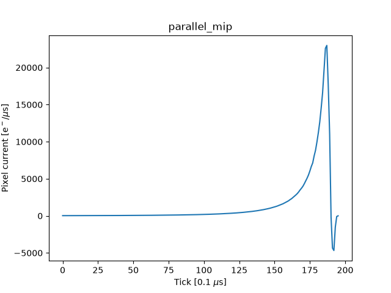

This repository contains a handful of simulated LArPix analog signals, as predicted by larnd-sim. The simulation, in most cases,[^1] is based on that of the Full Scale Demonstrator, whose v2d tiles have the same pixel pitch as v3. The full nominal HV is assumed, corresponding to a drift velocity of 1.6 mm/µs.

The following scenarios are covered:

- `parallel_mip`: MIP track (2.8 MeV/cm) parallel to anode and 3cm away (i.e. short current pulse on pixel). Horizontal and slicing through the pixel's center.
- `inclined_mip`: MIP track highly-inclined (85 degrees) to anode, 3-6cm away (i.e. long current pulse on pixel). Horizontal and symmetric about the pixel's center.
- `double_parallel_mip`: Two anode-parallel MIP tracks on same pixel, closely spaced in time, with separation of 2, 5, and 10 usec (closer track 3cm from anode; horizontal and slicing through the pixel's center)
- `clipping_mip`: MIP track clipping pixel (i.e. small pulse close to ~5000 ke- design self-trigger threshold): Parallel to anode, 45-degrees rotated in the "pixel" plane, 3cm away, shifted upward by 3/4 of a pitch.
- `parallel_hip`: HIP track (8.4 MeV/cm) on pixel (i.e. pulse with higher peak current on pixel). Same geometry as first case (parallel MIP track).
- `shower`: Shower on pixel (i.e. long pulse with lots of structure)

### Waveform files

Waveform files, in text format, can be found in the `waveforms` folder. Each line corresponds to one LArPix clock tick (100 ns); the value on each line is the current on the pixel, in units of e⁻/µs. See `plots.ipynb` for plots of all the waveforms.

### Reproducing the waveforms

Run `install.sh` to set up a Python environment and a local installation of larnd-sim. Activate the environment (`source .venv/bin/activate`) before proceeding.

Run `make_inputs.py` to mock up an edep-sim file for each scenario.

Run `run_larnd_sim.sh` on a machine with a GPU. This will run larnd-sim on each edep-sim file. The `save-wvfm-202608` tag of larnd-sim is used; this tag contains modifications to make it dump the analog signals seen by the pixels.

Run `extract_signals.py` to extract the signals and dump them to text. The pixel used is the one immediately above and "to the left of" the midpoint of the anode plane (when viewed from the cathode). This corresponds to pixel `102527` in the FSD.

To plot the waveforms, start a Jupyter session (`jupyter lab`), then open `plots.ipynb` and re-run all cells.

[^1]: The "shower" waveform was taken from a separate study on simulated showers in the FSD Cube geometry at half-nominal HV. Its location at NERSC, as well as the selected pixel ID, are hard-coded in `extract_signals.py`.
